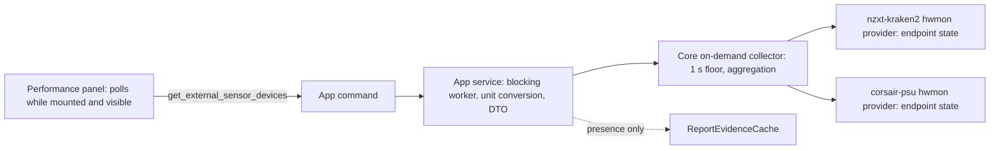

# External Sensor Devices Design

Status: proposed; waiting for maintainer design review. Not implemented.
Records the device model that the maintainer decision of 2026-11-28 on
[#2527](https://github.com/shm11C3/HardwareVisualizer/issues/2527) and
[#2531](https://github.com/shm11C3/HardwareVisualizer/issues/2531) calls for
(parent [#2510](https://github.com/shm11C3/HardwareVisualizer/issues/2510)).

The decision itself is settled. Readings from USB cooling and power devices
get a new device model. They are not added to the motherboard temperature and
fan lists, and they are not archived as fan history. This document decides
the shape of that model and how it moves through Core, App and frontend.

## Product Claim and Scope

On Linux, a user with an NZXT Kraken X42–X72 cooler or a Corsair HXi/RMi PSU
sees that device's live readings on the Performance Screen. Each reading is
attributed to its device and never mixed with motherboard, CPU or GPU
readings.

First consumers, both Experimental under
[ADR 0011](../adr/0011-experimental-sensor-enablement.md):

| Consumer | Spec (pinned) | Channels |
| --- | --- | --- |
| NZXT Kraken X42/X52/X62/X72, Linux `nzxt-kraken2` hwmon | [`cooler-nzxt-kraken-x42-x72.md`](../specs/sensors/cooler-nzxt-kraken-x42-x72.md) rev 2 | coolant temperature, fan RPM, pump RPM |
| Corsair HXi/RMi PSU, Linux `corsair-psu` hwmon | [`psu-corsair-hxi-rmi-linux-hwmon.md`](../specs/sensors/psu-corsair-hxi-rmi-linux-hwmon.md) rev 1 | VRM and case temperature, fan RPM, AC input voltage, total output power, +12 V / +5 V / +3.3 V voltage, current and power |

Later consumers reuse the model and add only the roles and quantities they
need: [#2528](https://github.com/shm11C3/HardwareVisualizer/issues/2528)
Aqua Computer (adds flow),
[#2529](https://github.com/shm11C3/HardwareVisualizer/issues/2529) MSI
CoreLiquid,
[#2530](https://github.com/shm11C3/HardwareVisualizer/issues/2530) USB fan
controllers and probes (adds several fans or probes per device),
[#2532](https://github.com/shm11C3/HardwareVisualizer/issues/2532) MSI PSU,
[#2533](https://github.com/shm11C3/HardwareVisualizer/issues/2533) WireView.

Out of scope: Windows and macOS providers (both specs keep them Unsupported),
fan, pump or lighting control, history and archiving, alerts, the Tray
Widget, Hardware Dashboard items and Product Analytics flags.

## Design Review Outcome

`Aligned with guardrail`. The model follows DP-02 (partial capability), DP-04
(work follows visible value), DP-05 (live lifetime kept distinct) and DP-07
(ownership). No principle needs an exception, so no ADR is required. The
guardrails are the tests named in [Verification](#verification): no external
reading reaches the motherboard lists, Power Draw or the Hardware Archive, and
two identical devices never share a key.

DP-12 check: the user outcome needs one live list of devices and nothing
else. This design adds no setting, no selection, no persisted state and no
second sampling path for the motherboard. The one piece of new structure is
the role-tagged channel list, which the maintainer decision requires so that
later devices reuse it.

## Vocabulary

Proposed `CONTEXT.md` entry, added with the Core model slice:

**External Sensor Device**: a USB-attached cooling or power device, such as
an all-in-one cooler, a PSU, a fan controller or a power monitor, whose live
readings belong to that device and not to the motherboard.
_Avoid_: motherboard sensor, peripheral, accessory, cooling dashboard.

"Fan Speed Reading", "Active Fan Reading", "Inactive Fan Reading" and
"Invalid Fan Reading" keep their meaning and apply to external fan and pump
channels. "Sensor Source Label" applies as is. "Power Draw" stays CPU, GPU,
ANE and package power only.

## Ownership

| Concern | Owner |
| --- | --- |
| Detection, safety gates, decode, admitted ranges, resume rule | One Core provider per spec under `hardviz/core/src/infrastructure/providers/linux/`, written by the clean-room implementer role from the pinned spec |
| Device and reading model, raw SI units | Core `models` |
| Per-endpoint provider state (Kraken resume rule, label qualification) | The provider instance, owned by the collector below |
| Rate floor, aggregation of providers, the one sampling owner | An on-demand Core collector in `hardviz/core/src/collector/`, held by App `WorkersState` like `LiveStorageHealthCollector` (ADR 0006, Design Rule 8) |
| Platform selection | `PlatformFactory`; the Linux platform supplies both providers, other platforms supply none |
| Temperature unit conversion, wire DTOs, command | App service and hand-written DTOs (like the motherboard display values, ADR 0009 keeps them out of generation) |
| Polling while visible, layout, labels, formatting | Frontend Performance panel |
| Persistence | None |

## Device Entity

One `ExternalSensorDevice` per qualifying endpoint:

| Field | Meaning |
| --- | --- |
| `key` | Session-local device key (see below). Opaque to every consumer. |
| `kind` | `Cooler` or `PowerSupply`. Later slices add `FanController` and `PowerMonitor` when a consumer needs them. |
| `display_name` | Family name from the spec's identity row, for example `NZXT Kraken X42–X72` or `Corsair HXi/RMi`. Presentation only; a product name never gates a read (ADR 0031). |
| `source` | Sensor Source Label, for example `kraken2 / Linux hwmon` or `corsairpsu / Linux hwmon`. |
| `availability` | `Available`, or `Unavailable` with a typed reason (below). |
| `channels` | Role-tagged channels (next section). |

The collection wraps the devices with `platform_support: SensorSupport`.
`Unsupported` on Windows and macOS. On Linux it is `Supported` and an empty
device list means no matching device was found.

Device unavailability reasons are an enum, not a string, so the frontend can
localize them and no behavior matches on text:

| Reason | When |
| --- | --- |
| `EndpointNotQualified` | The HID identity matches but the driver, hwmon ownership or label gate fails. |
| `AwaitingFreshReadings` | Kraken resume rule hold: first observation, re-qualification or detected suspend. |
| `NotResponding` | PSU timeout limit hit in this sample. |
| `NoUsableReadings` | Every channel of the sample is unavailable or out of range. |

### Session-local key

The key is built from the provider and the sysfs name of the qualifying HID
device, for example `linux-hid:0003:1B1C:1C05.0007`. A newtype carries it in
Core and a plain string carries it on the wire.

It must never be persisted or treated as a stable identity:

- The HID sequence suffix and the `hwmonN` number change across reboots and
  re-plugs (both specs, Attribution).
- No evidence shows that either device reports a USB serial number (Kraken
  Open question 8, Corsair Open question 8). Two identical PSUs can therefore
  not be told apart across sessions.
- A key that disappears and reappears is not proven to be the same physical
  device. A re-plug yields a new device in the session.
- DP-01: a persisted hardware identifier needs a product capability that uses
  it. Live-only presentation has none.

So the key is not written to `settings.json`, Tauri Store, the Hardware
Archive, the Hardware Compatibility Report or analytics. The frontend uses it
only as a React key while the device is listed.

Identity contract (verify-identity-contracts step 1):

| Source | Key shape | Shares a namespace with |
| --- | --- | --- |
| `get_external_sensor_devices` command, Linux | `linux-hid:<HID sysfs name>` | Nothing. Not motherboard fan names, not GPU ids. |
| Same command, Windows and macOS | No devices | n/a |

There is one source, so no join exists. Fixtures must use the real shape and
must include two devices of the same identity with different sequence
suffixes.

### Multiple devices of the same kind

Each qualifying HID device is one device. Its channels are never merged with
another device's channels, summed across devices, or deduplicated against
motherboard readings. A Kraken pump wired to a motherboard header through the
sense pin appears twice, once per source, each with its own attribution
(Kraken Open question 6).

When two listed devices share a display name, the frontend appends an
ordinal in key order (`Corsair HXi/RMi #1`, `#2`). The ordinal is a label for
this list only. It can shift after a hot plug, which is acceptable because
nothing refers to it later.

## Reading Roles and Quantities

A channel is a role plus a quantity. Its value is either a reading or
unavailable for this sample. A channel the endpoint does not offer (for
example a PSU rail whose label file is missing) is absent. A channel that is
offered but failed, timed out or fell outside its admitted range is present
and unavailable. Never zero.

| Quantity | Core unit | Roles in the first two consumers |
| --- | --- | --- |
| Temperature | °C, `f32` | `Coolant` (Kraken), `PsuVrm`, `PsuCase` (Corsair) |
| Rotational speed | RPM, `u32`, with `FanSpeedStatus` | `Fan` (Kraken, Corsair), `Pump` (Kraken) |
| Voltage | V, `f32` | `AcInput`, `RailOutput(Rail)` |
| Current | A, `f32` | `RailOutput(Rail)` |
| Power | W, `f32` | `TotalOutput`, `RailOutput(Rail)` |

`Rail` is `Plus12V`, `Plus5V` or `Plus3V3`.

Rules:

- Providers convert sysfs milli- and micro-units to these SI units. The App
  converts only temperature, to the user's unit. Number formatting is the
  view's.
- Speed channels reuse `FanSpeedStatus`: 0 RPM is an Inactive Fan Reading
  (a stopped PSU fan at low load is normal), a positive value is Active,
  malformed or out-of-range text is Invalid. Its doc comment drops
  "motherboard".
- Within one device, a role, rail and quantity triple appears at most once,
  so a rail keeps its voltage, current and power channels side by side. A later
  device with several fans or probes (#2530) adds a channel index in its own
  slice.
- No value is derived. No efficiency, no input power, no rail sum, no
  difference between channels. The channels of one PSU sample are read at
  different instants (Corsair spec, Attribution).
- `TotalOutput` is the PSU's reported DC output. It is not wall power and not
  CPU, GPU or package power.

### Keeping power apart

External power readings never enter `PowerDraw`, the Power panel, the
Instrument Strip, Power Draw graphs or archived power summaries. They live
only in the external device collection. This keeps CPU and platform power
from being counted twice when the PSU's output includes them. A later
WireView reading of GPU board power (#2533) follows the same rule and stays
attributed to the WireView.

## Live-only Presentation

Collection follows visible value (DP-04). Only the Performance panel requests
external device readings, so they are sampled only while that panel is
mounted and the window is visible. This also meets the Corsair spec's cost
rule: about 23 PSU exchanges per sample, at most once per second per PSU, and
only while readings are requested.

The readings are not part of `MetricsSnapshot`. That is what keeps them out
of the archive: `ingest_fan_speeds` in `persistence/archive.rs` reads only
`snapshot.motherboard_fan_speeds` and keys fan history by name, so a Kraken
`Fan` would otherwise collide with a motherboard fan of the same name. Nothing
reaches the Tray Widget or alerts either.

### If history is wanted later

Each of these changes, and needs its own decision:

1. A background consumer appears. Collection must continue while the window
   is hidden, which makes PSU traffic a background cost that has to be
   justified (DP-04). Under Design Rule 8 the on-demand collector becomes part of
   the periodic collector and its result is published through
   `EventBus` snapshots; the archive does not open a second sampler.
2. A stable device identity is needed. The session key is not one. A
   candidate (USB serial, if a device reports one, or USB port topology,
   which changes when the device is moved) needs evidence and a DP-01
   decision, as ADR 0003 did for storage devices.
3. A new archive family is needed, native-only under
   [ADR 0030](../adr/0030-native-only-persistence-for-new-families.md), keyed
   by device identity and role, never by display name.
4. Cooling Insight and the Hardware Archive vocabulary entries change.

## Data Flow

Core:

- `SensorPlatform` gains a method that returns this platform's external
  device providers. Its default returns none, which the collector reports as
  `platform_support: Unsupported`, so Windows and macOS need no code.
- The collector is one instance per process, created at startup and held in
  App `WorkersState`, following `LiveStorageHealthCollector`. It owns the
  provider instances. A call within one second of the previous read returns
  the cached collection, so several callers cannot raise the PSU traffic
  rate.
- Each provider keeps its endpoint state: the Kraken resume-rule state
  (recorded clock difference, hold start) and the label qualification. It
  resets that state when an endpoint is re-qualified, as the specs require.
- Reads block (PSU timeout up to 250 ms). The App service runs the call on a
  blocking worker, never on the async runtime thread.

App:

- One command, `get_external_sensor_devices`, registered in
  `collect_commands![...]`. It returns the collection with temperatures in the
  user's unit. Bindings are regenerated.
- The DTOs are hand-written, like the motherboard display values.

Frontend:

- A hook modelled on `useCpuDetailTemperatures` polls while the panel is
  mounted and `document.hidden` is false, and exposes `hasError` and `retry`.
  The panel is the only consumer, so the state stays in the hook. A second
  consumer would turn it into a shared-read atom (frontend `AGENTS.md`).
- The poll interval is 2 seconds, above the 1 second floor. The value is
  open for review.

### Where the readings appear

One new Performance panel, `externalSensorDevices`, titled "Cooling and power
devices". The layout normalizer adds it hidden on existing installs and
visible on fresh layouts, as it does for any new panel.

- One group per device: display name, Source Label, and a device-level
  unavailable line when the device is unavailable.
- Cooler: rows for coolant temperature, fan and pump, with fan status as on
  the Motherboard Sensors panel.
- PSU: rows for VRM temperature, case temperature, fan, AC input voltage and
  total output power ("Total output, PSU-reported"), then a three-row rail
  table (+12 V, +5 V, +3.3 V) with V, A and W columns.
- An unavailable channel renders `N/A`, never a blank or zero.
- Panel states: loading skeleton; `LoadFailure` on a failed read; "Not
  supported on this platform"; "No supported cooling or power device found";
  devices.

The Motherboard Sensors panel, the Hardware Dashboard motherboard card and
the Instrument Strip do not change.

## Hardware Compatibility Report

These are not motherboard readings. "Motherboard temperatures", "Motherboard
fans" and "Super I/O identification" keep reading only the motherboard lists
in `MetricsSnapshot`, so an external device never turns them to "Yes" or
changes the chip line.

Opening the report never starts a read. When the panel's read succeeds, the
App service records presence evidence in `ReportEvidenceCache`, as the
inventory and Storage Health reads already do. The report then adds:

- under Sensor providers: `Linux nzxt-kraken2 hwmon` and
  `Linux corsair-psu hwmon`, each `Available` when a device of that provider
  was listed, otherwise `Not recorded`;
- under Readings available to the app: `External cooling device readings` and
  `External power device readings`, `Yes` when at least one channel had a
  value.

The evidence holds no key, no reading value and no count of devices.

## Linux Platform Combination

The external collection and the motherboard collection are independent:

- `LinuxPlatform::sample_motherboard_sensors` keeps returning only the
  motherboard provider (today the NCT6686D profile provider). Its
  `availability` and `fan_support` describe the motherboard only.
- A Kraken or PSU fan never makes `motherboard_fan_support` `Supported`. An
  unsupported or unavailable motherboard never hides an external device.
- `sample_external_sensor_devices` on Linux runs the Kraken and PSU providers
  in turn and concatenates their devices, ordered by kind, then key. One
  provider finding nothing or failing does not affect the other (partial
  results, DP-02).
- Neither provider produces External Component Guidance. The drivers are
  in-tree kernel drivers that the kernel loads, not optional components the
  app installs. A matched but unbound device is `EndpointNotQualified`,
  without guidance.

## Alternatives Considered

| Alternative | Why not |
| --- | --- |
| Add the readings to the motherboard lists with a Source Label | Rejected by the maintainer decision. It would also archive Kraken and PSU fans as fan history keyed by name, show one source label for the whole list, change "Super I/O identification" and `motherboard_fan_support`, and leave no place for voltage, current or PSU power. |
| Sample in the collector and publish in `MetricsSnapshot` | Every tick would pay PSU traffic and a possible 250 ms timeout while the window is hidden and nothing shows the values, delaying tray and archive work. No background consumer exists yet. This becomes the right shape when history is wanted. |
| Reuse `EnvironmentalSensorProvider` | It models one ambient temperature and humidity reading for the archive tick, with freshness rules for the archive. Device channels, roles and live-only presentation do not fit it. |
| Generic channels with hwmon label and unit strings | Behavior and grouping would depend on strings (root `AGENTS.md`), and nothing would stop a PSU power channel from being read as Power Draw. |
| One fixed struct per device kind | Typed, but #2528–#2533 bring variable channel counts and new quantities, so every family would add a struct and a view. One role enum grows by a variant instead. |
| Persist a device identity now | No stable identifier is evidenced, and no live-only feature needs one (DP-01). |

## Verification

| Claim | Evidence |
| --- | --- |
| No external reading reaches motherboard lists, `PowerDraw` or the archive | Core test: a platform fake with external devices yields a `MetricsSnapshot` whose motherboard lists and power are unchanged; archive ingest sees no external fan. |
| Two identical devices stay separate | Provider fixture tests with two `1B1C:1C05` HID devices that differ only in the sequence suffix; collector test that their channels and cached samples never mix. |
| Rate floor | Collector test: two calls within one second cause one provider read. |
| Partial results | Collector test: one provider fails, the other's devices are returned. |
| Spec behavior (gates, decode, ranges, resume hold, timeout limit) | The synthetic fixture acceptance sets of each spec. |
| Compatibility report | Render tests: an external device leaves the motherboard lines and Super I/O line unchanged and adds only the new presence lines; nothing is recorded before a read. |
| Panel states and layout | Component tests for each panel state and for `N/A` channels; layout normalizer test that the panel arrives hidden on an existing layout; e2e mock with one Kraken and two identical PSUs. |
| Rendered result | Screenshots of the panel at desktop and compact widths, light and dark. |
| Cost follows visibility | Hook test: no command call while the panel is unmounted or the document is hidden. |

## Implementation Slices

Stacked PRs, one per layer, then one per provider:

1. Core model: types, `CONTEXT.md` entry, the provider trait and the
   `SensorPlatform` default method, the on-demand collector with rate floor
   and provider aggregation, tested with fake providers.
2. App wiring: command, service, DTOs, temperature conversion, report
   evidence and lines, regenerated bindings, e2e mock data.
3. Frontend: panel id, hook, panel, language strings, layout tests,
   screenshots.
4. Kraken X42–X72 provider: clean-room implementation from spec rev 2,
   including the resume rule, under the spec README's implementation gate.
5. Corsair HXi/RMi provider: clean-room implementation from spec rev 1,
   including label qualification and the timeout limit.

Slices 4 and 5 are independent of each other once slice 1 lands.

## Open Questions

1. Display name: the family name (`Corsair HXi/RMi`) or a per-identity model
   name where the Corsair Model inventory maps one product id to one model
   (`HX750i` for `1C05`). Some ids are shared (`1C1F`), and the Kraken
   identity always covers four models.
2. Default visibility on fresh layouts where `platform_support` is
   `Unsupported` (Windows and macOS today): keep the panel visible with its
   unsupported state, as with the other panels, or leave it out of fresh
   layouts on those platforms.
3. Panel title and placement: a separate "Cooling and power devices" panel,
   or one panel per kind.
4. Poll interval: 2 seconds as proposed, or the user's monitor interval.
5. Whether the Hardware Dashboard should show external devices in a later
   slice. This design adds none.
