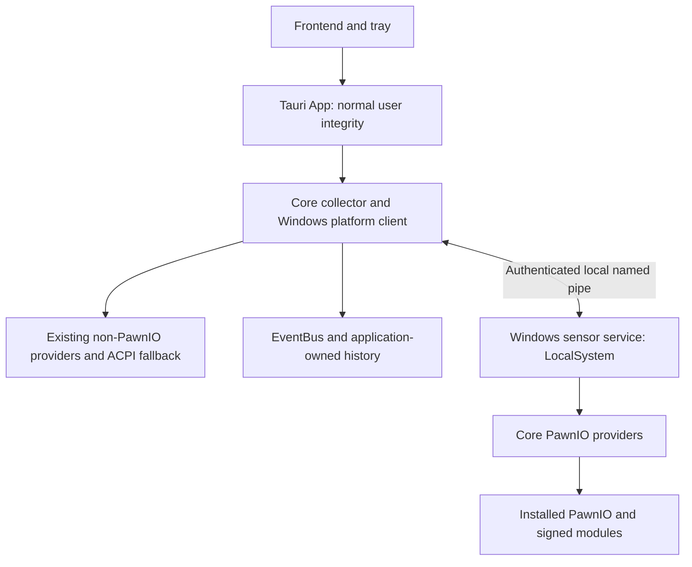

# Windows Sensor Service Design

Status: decided under [ADR 0029](../adr/0029-windows-sensor-service.md).
Implemented in this change; Windows hardware/logon and signed-artifact
qualification remain release gates. Tracks [#2508](https://github.com/shm11C3/HardwareVisualizer/issues/2508).

## Product Claim and Scope

After protected MSI installation or upgrade, HardwareVisualizer can start at
logon and remain in the tray at normal user integrity while retaining its currently supported
PawnIO readings. Routine launch, reconnect and reopening require no UAC.
Installation, repair and updates remain privileged operations. Existing users
who selected Elevated Startup Mode must explicitly switch that preference.

Move CPU package temperature and thermal status, CPU package power, motherboard
temperatures/fans and existing bounded read-only sensor diagnostics. Keep
ACPI fallback, GPU/process monitoring, ordinary inventory, collection policy,
history, settings and rendering in the app. New chips, new metrics, fan/control
writes, SMART privilege expansion and remote monitoring are outside this work.

## Process Boundary and Ownership

| Concern | Owner |
| --- | --- |
| Hardware decoding, safety gates, mutexes, supported/experimental scopes | Existing Core providers; derived only from pinned clean-room specs |
| SCM lifecycle and service process entry point | New standalone Windows service binary crate, independent of Tauri |
| Typed IPC contract and platform transport/client | Tauri-independent code owned with the service/Core boundary; never generated frontend bindings |
| Privileged sampler and in-memory latest readings | Service, reusing Core providers without starting the full Core collector or persistence workers |
| Demand from foreground, Tray Widget and explicit background/archive work | Existing app/Core collection policy, conveyed by the Core Windows client |
| Fallback, aggregate partial-result semantics and EventBus | Core platform/collector in the app |
| Setup orchestration, settings, presentation and shutdown | App services and lifecycle; OS operations remain behind Core platform APIs |
| Service packaging, registration, rollback and removal | App's protected MSI feature |
| All user databases and settings | Existing app/Core owners; no service writes or second archive owner |

The service uses low-level provider entry points, not the app-side platform
client, to avoid an IPC recursion. The resident app no longer opens PawnIO on
this path, even if the app was explicitly launched elevated. Retain bounded
ecosystem mutex waits because other monitoring programs remain independent
hardware owners outside this product.

The service owns provider instances and can close/reinitialize them for idle
release, reprobe after component repair and power-baseline reset. Intel
temperature and power retain a shared executor; failed initialization is
retried at bounded intervals. The app never starts a local provider as a
reconnect workaround.

## Trust Boundary

Run the service as LocalSystem because the unchanged PawnIO DACL admits SYSTEM
and Administrators. LocalService alone is not admitted. Do not introduce user
passwords, weaken the driver ACL or claim that this removes all privileged
code. Minimize service token privileges where compatible with the provider
and shared-mutex contracts; verify restrictions against actual driver access.

The service executable, DLL dependencies and module inputs must reside in
administrator-controlled locations. Use fixed installation roots, validated
final paths and safe DLL search rules; reject user-writable/reparse redirection.
Do not reuse broad recursive discovery as proof of trust. Do not load plugins,
user-supplied DLL paths, environment/PATH overrides, unsigned test modules or
per-user configuration in this privileged process. Keep the existing pinned
setup/download verification and the driver's signed-module enforcement. An
unrecognized external file is never overwritten as a repair shortcut.

Runtime requests accept no file paths, module blobs, register/port addresses,
function names, shell commands, installer arguments or arbitrary sampling
programs. Installing/updating components remains outside the runtime pipe and
requires the protected installer/elevated setup path. The runtime service
performs no network requests and stores no readings on disk.

### Named Pipe Authorization

Use one fixed local endpoint owned by the machine service. Its explicit DACL
admits SYSTEM and authenticated interactive logons on this computer for only
the required connection/data rights. Reject anonymous and network callers and
set `PIPE_REJECT_REMOTE_CLIENTS`; a locally executing RDP session is still a
local interactive client. A medium-integrity policy excludes low-integrity
clients. Do not grant clients `FILE_CREATE_PIPE_INSTANCE`, `WRITE_DAC`, service
reconfiguration, stop or other administrative rights. Use first-instance
protection when claiming the endpoint; a squatted name fails closed.

Authorize the connected Windows token, not a claimed SID, username, PID or
executable path supplied in a message. The policy intentionally permits any
process of an authorized interactive user to read these host sensor facts;
it is not an application-executable allowlist or a claim that same-user malware
cannot see readings. No process list, account data, user settings or archive
contents cross this interface.

Before accepting readings or sending demand, the client compares the OS-reported
pipe server PID with the running SCM service PID, verifies that the protected
service registration specifies a dedicated LocalSystem process, and rechecks
both identities after the query. A pipe name or protocol greeting alone does
not authenticate the server. Repeat authentication on reconnect; a changed PID
or stopped service gives unavailable data. Do not require opening the SYSTEM
process or token: those rights can be denied to the ordinary users this service
is intended to support. SCM query rights suffice; service reconfiguration remains
administrative.
Clients request identification-only impersonation quality; the service must
not perform sensor access while impersonating a normal client.

## IPC and Sampling

Use framed, typed, versioned messages with a length cap checked before
allocation. Start with one supported protocol major version; incompatible
peers return an explicit mismatch instead of guessing at message shapes.
Exchange service/build version and supported capabilities before subscribing.

| Operation | Allowed effect |
| --- | --- |
| Hello/capabilities | Authenticate compatibility and discover supported sensor families |
| Sample request / connection expiry | Renew demand for enumerated sensor families and return a shared, rate-limited acquisition |
| Snapshot delivery | Send latest typed readings, per-family outcome and acquisition metadata |
| Read-only diagnostics | Existing fixed sensor diagnostic operations, serialized and rate-limited; no raw access parameters |

Keep exact frame layouts, error enums and limit constants with the transport
code/tests when implemented. This document fixes their safety/ownership
constraints rather than maintaining a second byte-level specification.

There is one machine-wide sampling owner and at most one in-flight acquisition
per provider. Merge valid client demand; more clients must not multiply
hardware transactions. Preserve current sampling policies and provider minimum
intervals, including ITE's existing 1.5-second floor. The service caps CPU acquisition
at 1 Hz and motherboard acquisition at one per 1.6 seconds; the latter leaves
headroom for the coarse Windows uptime clock so an ITE cached value cannot be
restamped as a new acquisition. Honor explicit background
archive/tray demand even with a hidden window. Leases expire after a bounded
interval without renewal, so crashed/disconnected apps cannot leave permanent
polling. No active lease means no sensor reads; bounded idle cleanup releases
provider handles. A later subscription reinitializes them safely.

Use bounded client counts, per-user request budgets, queues and deadlines.
Slow clients receive the latest result or disconnect; they never block the
shared sampler. Connection and handshake run asynchronously with bounded
timeouts; retry with capped backoff. SCM may restart a crashed service under a
bounded recovery policy, but runtime clients cannot request privileged repair
or force an automatic whole-app elevation.

### Data, Identity and Freshness

Carry existing raw units, source labels, partial availability, independent
`SensorSupport`, fan `rpm: Option<u32>`/status, and CPU thermal status through
the transport. Successful experimental readings retain their existing product
semantics. Transport failures are distinct from unsupported hardware; do not
flatten all failures into a missing PawnIO installation.

The current producer contracts are:

| Reading | Producer / current identity | Transport rule |
| --- | --- | --- |
| CPU package temperature | `cpu_temperature.rs` supplies a source enum; `platform/windows/sensors.rs` maps it to a label | Preserve the source and raw Celsius value; do not manufacture a device ID |
| Motherboard temperature/fan | `super_io/motherboard.rs` supplies provider `source` and channel `name`; Core models have no persistent sensor ID | Preserve labels and channel association, including optional/absent readings; never join by compacted vector position |
| Package power | `cpu_power.rs` supplies the CPU package domain | Preserve `cpu_watts` semantics; do not populate derived total power or invent per-CPU IDs |

There is no new identity namespace or persisted selection in this slice.
Service generation and sample sequence identify acquisitions, not hardware.
Any later identity/selection change must verify the actual producer contracts
separately rather than treating transport sequence numbers as sensor IDs.

Snapshots include a service-generation identifier, per-provider sequence and
actual acquisition age/time on a shared Windows monotonic timebase. Reused
provider cache values retain their original acquisition time. The app validates
age, sequence and generation, applies a bounded freshness deadline tied to the
effective cadence, and stops publishing values as current when it expires.
Reject impossible future timestamps and out-of-order/replayed acquisitions.
Do not stamp a cached value as newly acquired when delivering or reconnecting.

On reconnect, discard the client's transport cache and authenticate again.
Service restart, sleep/resume or a sampling discontinuity invalidates the
service-owned RAPL baseline; its first new baseline can legitimately have no
watts. Reconnecting one client must not reset a continuously running sampler
or the power baseline used by other clients. Preserve existing history without
backfilling a disconnected period or inserting a replayed acquisition as a new
observation. The app remains the only owner that decides how valid current
samples enter history.

## Setup, Maintenance and Migration

The implementation includes a standard machine-wide service feature in
the MSI under an administrator-controlled Program Files installation. The
service is this application's component, not a shared PawnIO component. Use
normal Windows Installer service ownership and transactional upgrade/rollback;
do not use a user-writable result file, current executable or startup task as
the privileged installation authority.

- Interactive setup explains the app-owned background service. New installs and
  upgrades include it at every UI level, without a separate feature choice.
  PawnIO driver setup retains its existing explicit consent policy.
- Settings shows readiness and an explicit repair action routed to the
  protected MSI feature. An already installed app can restore that feature using
  its trusted matching MSI package. A standard user may supply administrator
  credentials without transferring their profile/settings ownership to that
  account. Cancelled consent keeps the app running with partial capability.
- Register the bundled service for automatic startup. It can run idle before
  logon, but does not poll hardware until client demand arrives. Missing driver
  or modules does not create a service restart loop or install them silently.
- Include and maintain the service during product updates using the
  installer's existing elevation context. Stop the sampler and close handles
  before replacement; restart and require a new handshake. Rollback restores
  the previous executable, registration and feature/start state. A
  restart failure leaves explicit unavailable data, never app elevation.
- Define and test an app/service compatibility pair for each release.
  Incompatible older/newer clients degrade without attempting a binary
  downgrade. Mixed NSIS/portable clients cannot own, replace or remove the
  machine service. Their first-time setup guidance points to the protected
  MSI installation; an already compatible service may be used.
- Full uninstall of the owning product stops and removes its service and
  executable; upgrades must not accidentally run that full-removal path.
  Shared PawnIO, modules and other users' applications remain intact. Do not
  leave an orphan SYSTEM service pointing to a removed executable.

Keep `elevatedStartupMode=false` for new/default settings. For an existing true
value, preserve it until the user turns off the existing elevated-startup
setting. That single control owns startup intent; the service panel owns status
and repair. Save through typed Rust IPC in `settings.json`, preserving keys
owned by the other crate. Explain that other privileged providers may expose
less data after switching. Do not automatically fall back to whole-app
elevation when the service later becomes unavailable.

Automatic sensor guidance is one nonmodal notice. It uses failed-attempt
diagnostics carried by the existing hardware monitor event and relevant to
visible readings. It does not query service status or infer readiness from
missing or present temperatures. Closing it silences the
notice for this launch; existing per-key permanent suppressions are retained.
Settings owns status reads, explicit repair and the existing startup toggle.
There is no separate sensor-guidance timer, startup deadline or modal queue.
Successful upgrades get no migration CTA. Release notes explain the new
capability; the elevated-startup setting explains that CPU and motherboard
readings need no whole-app elevation, that existing choices are preserved and
that changing the preference requires exiting and launching normally. The
service may still be unavailable on a portable/unprotected installation;
failure guidance remains relevant there after collection and fallbacks fail.

The current process cannot discard elevation in place. Apply the preference
to the next normal user launch; never relaunch from the elevated parent and
claim the child is unelevated without token evidence. Preserve autostart and
Close to Tray settings. Explain how to remove the article's highest-privilege
scheduled-task workaround, but do not edit user-created tasks, compatibility
flags or shortcuts automatically. Do not remove ADR 0007's older-resident
activation compatibility while those binaries remain supported.

## Failure Behavior and Proof

| Condition | Required app behavior |
| --- | --- |
| Service missing, disabled, stopped or crash-looping | Start normally; bound retries, retain other data and offer setup/repair only after attempted access leaves important data unavailable |
| Server identity, authorization or protocol failure | Reject the connection/data, distinguish the failure, never execute supplied paths or silently elevate |
| Driver/DLL/module missing or denied | Report the component-specific reason; attempt existing useful fallback before guidance |
| Unsupported chip or partial provider failure | Preserve existing support/availability distinctions and other valid channels; no misleading installation guidance |
| Disconnected, stale or resumed connection | Expire current values, retain history, reconnect with new baselines and no replay |
| Setup cancelled or rolled back | Preserve prior settings/component ownership and keep normal monitoring usable |

Use focused tests at the new boundaries: authorization and server spoofing;
framing/version/size limits; request/lease/client bounds; sampling deduplication;
provider safety intervals; partial capability and identity; freshness/restart
and power baselines; setup consent and preference preservation. Transport work
must not bypass the clean-room implementation gate for sensor-file changes.

Before release, inspect signed service/installer artifacts and actually install,
launch at logon, close to tray, reopen, sleep/resume, disconnect/restart the
service, update/rollback and uninstall on Windows. Cover a filtered administrator
token and a separate standard user (including alternate administrator credentials
for setup), multiple sessions/clients, missing components and NSIS partial mode.
Inspect process tokens and logs to prove normal-integrity app + privileged
service, no routine UAC, one sampler and one app-owned database. Record Intel,
AMD and supported Super I/O hardware actually exercised separately from mocks.

Implementation slices and acceptance checkboxes live in the tracking issue.
The Windows-only packaging hook is PowerShell, alongside the existing signer
and MSI checks; the frontend remains a Node build. The MSI embeds a validation
copy of the signed service executable and validates the target directory and
its ACL ancestry before placing or starting the installed copy. The check
also rejects untrusted write permissions that the installation directory
would pass to the new executable. Ancestors are checked for effective access;
the target directory owns the new-file inheritance check, including the normal
trusted-creator template used by Windows.
Production module loads require known signed-release hashes; unknown files remain intact
and are reported as incompatible rather than overwritten.

Exact SCM/pipe permissions under separate Windows accounts, installer
credential elevation and upgrade/rollback still need real-machine evidence.
Automated tests and MSI table inspection do not prove logon or hardware behavior.

## References

- [PawnIO privilege contract, rev 7](../specs/sensors/pawnio-interface.md#privilege-requirement-windows)
- [Current Core/App architecture](../architecture/backend.md)
- [External Component Setup](external-component-setup.md) and
  [refresh policy](../adr/0026-refresh-outdated-external-component-files.md)
- [Microsoft: LocalSystem account](https://learn.microsoft.com/en-us/windows/win32/services/localsystem-account)
- [Microsoft: named pipe security](https://learn.microsoft.com/en-us/windows/win32/ipc/named-pipe-security-and-access-rights)
- [Microsoft: CreateNamedPipe](https://learn.microsoft.com/en-us/windows/win32/api/winbase/nf-winbase-createnamedpipea)
- [Microsoft: GetNamedPipeServerProcessId](https://learn.microsoft.com/en-us/windows/win32/api/winbase/nf-winbase-getnamedpipeserverprocessid)
- [Microsoft: service security](https://learn.microsoft.com/en-us/windows/win32/services/service-security-and-access-rights)
